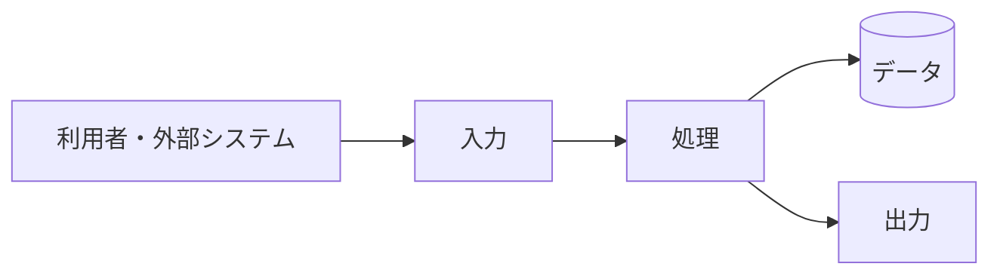

# (システム名) AWS アーキテクチャ設計

## 結論

(要件に対して何を設計したか、未承認ならその状態を 1〜3 行で書く)

## 対象と承認状態

| 項目 | 内容 |
| --- | --- |
| 対象環境 | (記入) |
| 要件 | (requirements.yaml へのリンク) |
| Gate 1 | 未承認 / 承認済み |
| Gate 2 | 未承認 / 承認済み |
| 設計責任者 | (記入) |
| 承認者 | (記入) |

## システム境界

(利用者、外部システム、対象システム、対象外を示す)

## 論理アーキテクチャ

(AWS サービス名を先に置かず、処理、データ、メッセージ、外部連携の責務を示す)

## AWS 物理アーキテクチャ

(採用した AWS サービス、アカウント、リージョン、ネットワーク、接続を示す)

## データフロー

| ID | 起点 | データ | 経路 | 保存先 | 暗号化 | 関連要件 |
| --- | --- | --- | --- | --- | --- | --- |
| DF-001 | (記入) | (記入) | (記入) | (記入) | (記入) | (記入) |

正常系だけでなく、失敗、再試行、DLQ、再処理、復旧の流れも記載する。

## 信頼境界と権限

| 境界 | 実行主体 | 許可する操作 | 対象 | 認証・認可 | 検証 |
| --- | --- | --- | --- | --- | --- |
| (記入) | (記入) | (記入) | (記入) | (記入) | (記入) |

## 設計判断

| ADR | 判断 | 関連要件 | 状態 |
| --- | --- | --- | --- |
| (リンク) | (記入) | (記入) | 提案 / 承認 / 置換済み |

## 要件との対応

| 要件 ID | ADR | AWS リソース | 統制 | 検証 |
| --- | --- | --- | --- | --- |
| (記入) | (記入) | (記入) | (記入) | (記入) |

## 障害と復旧

(単一障害点、依存先停止、RTO、RPO、バックアップ、復元、ロールバックを書く)

## 監視と運用

(メトリクス、アラーム、通知先、Runbook、ログ保持を書く)

## 費用条件

(利用量、稼働時間、環境、データ転送、ログ、バックアップを含む見積条件を書く。推測値は書かない)

## リスクと未決事項

| ID | 内容 | 影響 | 責任者 | 期限 |
| --- | --- | --- | --- | --- |
| (記入) | (記入) | (記入) | (記入) | (記入) |

## 承認

| Gate | 状態 | 承認者 | 日時 | 条件 |
| --- | --- | --- | --- | --- |
| Gate 1 | (記入) | (記入) | (記入) | (記入) |
| Gate 2 | (記入) | (記入) | (記入) | (記入) |
